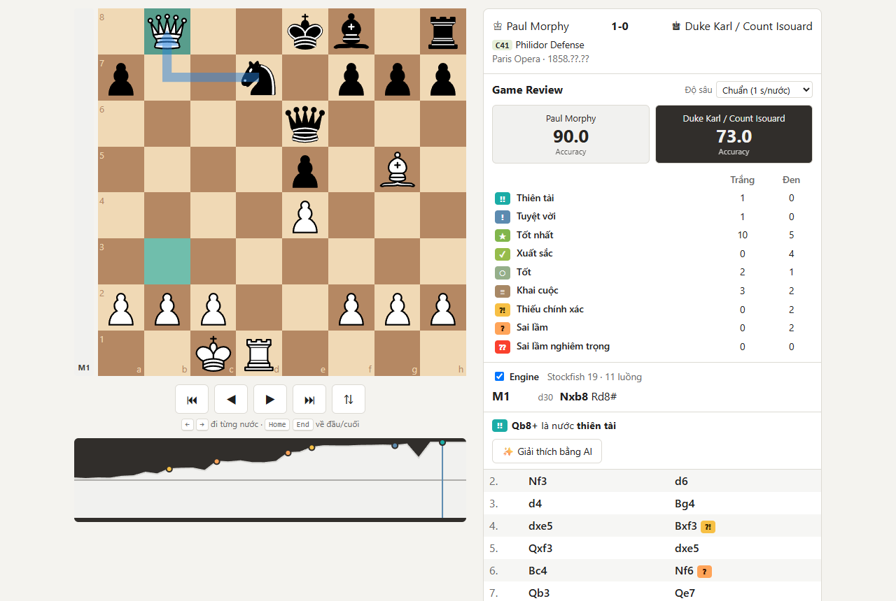
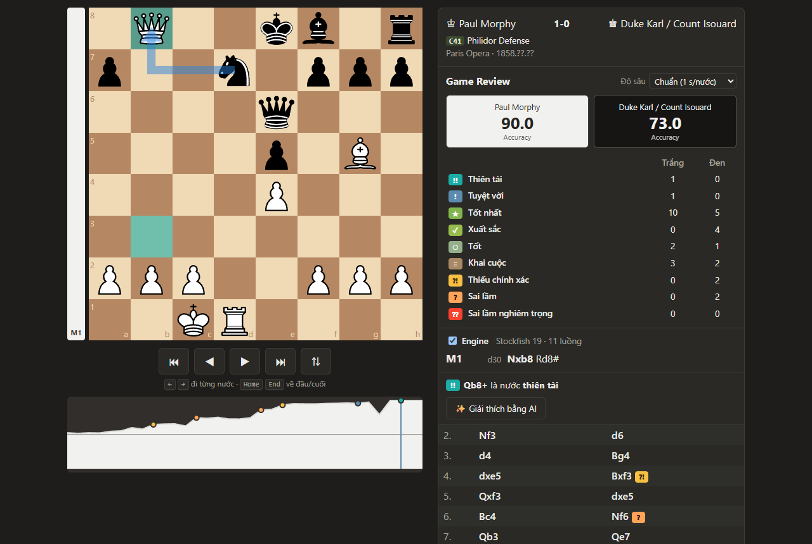

# ♞ Chess Review

Web app review ván cờ giống **Game Review của chess.com**, chạy **hoàn toàn trên trình duyệt**: Stockfish 19 (WebAssembly, đa luồng) phân tích từng nước, chấm nhãn từ *Thiên tài* tới *Sai lầm nghiêm trọng*, tính Accuracy theo công thức của lichess, và có thể nhờ Claude giải thích vì sao một nước là sai lầm.

Không có backend và không có database. Mọi phân tích đều chạy trên máy người dùng.



<details>
<summary>Giao diện tối</summary>



</details>

## Tính năng

- **Nhập ván**: kéo ván theo username từ API công khai của chess.com (lọc Bullet/Blitz/Rapid/Daily), hoặc dán PGN.
- **Phân tích bằng Stockfish 19** chạy trong Web Worker:
  - **cả ván**: 5 engine Full chạy song song, mỗi engine một vị trí. Ván 100 vị trí mất khoảng 18 s; mức "Nhanh" dùng 11 engine Lite, khoảng 8 s;
  - **vị trí đang xem**: bản Full đa luồng (trong lúc tải, bản Lite 1.7 MB chạy trước);
  - tự quay về bản Lite khi máy ít RAM hoặc trình duyệt không hỗ trợ đa luồng.
- **Chấm từng nước**: Thiên tài `!!`, Tuyệt vời `!`, Tốt nhất, Xuất sắc, Tốt, Khai cuộc, Thiếu chính xác `?!`, Sai lầm `?`, Sai lầm nghiêm trọng `??`.
- **Accuracy** cho từng bên theo thuật toán của lichess. Với ván từ chess.com, app hiện cả Accuracy của chess.com để so sánh.
- **Nhận diện khai cuộc** (mã ECO + tên, theo từng nước) và nhãn Book, từ bộ dữ liệu lichess chess-openings (3.865 biến có tên, 7.982 thế cờ).
- **Biểu đồ eval** theo từng nước: bấm vào biểu đồ để nhảy tới nước đó.
- **Gợi ý nước đúng**: mũi tên xanh lá chỉ nước nên đi ở những nước dở; mũi tên xanh dương là nước tốt nhất của phân tích live.
- **Giải thích bằng AI**: Claude diễn giải *dữ liệu của Stockfish* (biến chính, eval), không tự tính cờ. Người dùng dùng API key của chính mình.
- **Luyện chiếu hết** (tab riêng, màn review vẫn giữ nguyên):
  - 15.000 puzzle chiếu hết từ kho puzzle của lichess (Mate in 1 đến 5+, 3.000 bài mỗi mức, chọn bài phổ biến và nhiều lượt chơi, không trùng thế cờ; có chế độ ngẫu nhiên 1–3 nước và 1–5 nước; không ra lại bài đã gặp cho tới khi gặp hết);
  - chiếu hết cơ bản Vua + Hậu, Vua + Xe, Vua + 2 Tượng, Vua + Tượng + Mã, với Stockfish phòng thủ. Hòa pat, mất quân, lặp 3 lần hay luật 50 nước đều tính là chưa đạt;
  - giới hạn thời gian cho từng bài; đồng hồ chỉ chạy trong lượt của bạn;
  - **premove nhiều nước**: trong lượt đối phương, xếp sẵn nhiều nước (ô tô đỏ). Tới lượt bạn, nước đầu được đi ngay, không mất giờ; premove không hợp lệ thì cả hàng bị hủy. Chuột phải hoặc Esc để hủy;
  - "Xem đáp án", "Thử lại", thống kê chuỗi đúng (lưu trong trình duyệt).
- Âm thanh nước đi (tự tổng hợp bằng Web Audio), phím tắt ← → Home End, giao diện mobile, dark mode.

## Chạy thử

Yêu cầu Node.js 20.19+ hoặc 22.12+ (theo Vite 8).

```bash
npm install
npm run dev        # http://localhost:5173 (tự copy file Stockfish vào public/)
npm test -- --run  # unit test (Vitest)
npm run build      # build production vào dist/
```

### Deploy

Stockfish đa luồng cần `SharedArrayBuffer`, nên trang phải gửi 2 header:

```
Cross-Origin-Opener-Policy: same-origin
Cross-Origin-Embedder-Policy: require-corp
```

[`vercel.json`](vercel.json) đã cấu hình sẵn cho **Vercel**, kèm Content-Security-Policy chỉ cho phép gọi `api.chess.com` và `api.anthropic.com`. GitHub Pages không đặt được header nên chỉ chạy được bản Lite một luồng.

Muốn thử bản build với đúng các header khi deploy (CSP, COOP/COEP): `npm run build && npx vite preview`.

## Kiến trúc

```
PGN / chess.com API ─► chess/ (GameModel: FEN trước/sau mỗi nước)
                              │
            engine/ (Stockfish trong Web Worker, giao tiếp UCI)
                              │  eval từng vị trí, góc nhìn Trắng
            analysis/ (win%, phân loại nước, Accuracy — hàm thuần, có test)
                              │
            components/ (bàn cờ, eval bar, biểu đồ, danh sách nước, AI)
```

| Thư mục | Vai trò |
|---|---|
| `src/chess` | Parse PGN, điều hướng, đổi biến UCI sang SAN, nhận ra ván kết thúc (kể cả lặp 3 lần) |
| `src/engine` | Bọc Stockfish (UCI, MultiPV). Engine live đa luồng cho vị trí đang xem; **pool nhiều engine 1 luồng chạy song song** cho phân tích cả ván |
| `src/analysis` | Lõi chấm điểm: `winPercent`, `classifyMove`, `gameAccuracy`, heuristic thí quân |
| `src/openings` | Tra cứu khai cuộc theo EPD |
| `src/api` | Tải ván chess.com (tuần tự từng tháng, có phân trang và thử lại) |
| `src/ai` | Prompt và client Claude (stream, fallback, xử lý lỗi theo loại) |
| `src/training` | Luyện chiếu hết: chấm puzzle, sinh thế cờ chiếu hết cơ bản, premove, đồng hồ, luồng một lần làm bài (hàm thuần, có test) |

Một vài quyết định kỹ thuật đáng chú ý:

- **Quy ước góc nhìn**: Stockfish báo eval theo *bên đang tới lượt*. Mọi eval được đổi về góc nhìn Trắng khi lưu, rồi đổi sang góc nhìn *người vừa đi* khi chấm nước. Đây là nguồn lỗi phổ biến nhất của các app kiểu này.
- **Phân tích cả ván song song**: các vị trí trong ván độc lập nhau, nên thay vì dồn 11 luồng vào một vị trí, app chạy 5 engine Full 1 luồng, mỗi engine một vị trí. Đo trên ván 108 vị trí: **~18 s thay vì ~72 s**, chất lượng nhãn ngang nhau. Mức "Nhanh" dùng 11 engine Lite (~8 s). Số engine tự giảm theo số nhân CPU và RAM; engine nào crash thì vị trí của nó được giao cho engine khác. Trong lúc chạy, phân tích live tạm dừng để nhường CPU.
- **Lặp 3 lần**: engine nhận `position fen <start> moves …` thay vì chỉ FEN, nên nhận ra được hòa do lặp.
- **Tách bundle**: Stockfish (khoảng 99 MB, cache vĩnh viễn), biểu đồ, dữ liệu khai cuộc và Anthropic SDK đều chỉ tải khi cần.

## Cách chấm điểm

Chi tiết công thức và ngưỡng nằm ở [docs/scoring.md](docs/scoring.md). Tóm tắt:

- **Nhãn nước đi theo định nghĩa chess.com công bố:**
  - "điểm kỳ vọng" bị mất ≤ 0.02 là Xuất sắc, ≤ 0.05 là Tốt, ≤ 0.10 là Thiếu chính xác, ≤ 0.20 là Sai lầm, còn lại là Sai lầm nghiêm trọng;
  - Thiên tài (thí quân tốt), Tuyệt vời (nước quyết định kết quả), Bỏ lỡ (không tận dụng nước dở của đối phương);
  - nước khai cuộc luôn là Book.
- Điểm kỳ vọng tính bằng `win% = 50 + 50·(2/(1+e^(−0.00368208·cp)) − 1)` của lichess, vì chess.com không công bố công thức theo rating của họ.
- Accuracy cả ván theo công thức công khai của lichess, vì công thức CAPS của chess.com không được công bố.

## Giải thích bằng AI

Nút "Giải thích bằng AI" gửi cho Claude (`claude-opus-5-5`) **chỉ dữ liệu engine**: FEN, nước đã đi, eval trước/sau, nước tốt nhất kèm biến chính, và biến trả đòn của đối phương. Prompt yêu cầu mô hình không tự tính thêm nước, vì mô hình ngôn ngữ tính cờ không chính xác.

API key là của người dùng:
- mặc định chỉ giữ trong `sessionStorage`, chỉ lưu `localStorage` khi người dùng chọn "nhớ";
- request đi thẳng từ trình duyệt tới `api.anthropic.com`, không qua server trung gian;
- bị xóa ngay nếu API báo key không hợp lệ.

## Công nghệ

Vite · React 19 · TypeScript (strict) · chess.js · react-chessboard · Stockfish 19 (stockfish.js) · recharts · @anthropic-ai/sdk · Vitest · oxlint

## Giấy phép và ghi công

Mã nguồn phát hành theo **GPL-3.0-or-later** (xem [LICENSE](LICENSE)), vì có đóng gói Stockfish (GPL-3).

- [Stockfish](https://stockfishchess.org) và [stockfish.js](https://github.com/nmrugg/stockfish.js) — GPL-3.0
- [lichess-org/chess-openings](https://github.com/lichess-org/chess-openings) — CC0 (dữ liệu khai cuộc)
- [Kho puzzle của lichess](https://database.lichess.org/#puzzles) — CC0 (bài tập chiếu hết, tạo lại bằng `node scripts/build-puzzles.mjs <lichess_db_puzzle.csv.zst>`)
- Công thức win% và Accuracy theo mã nguồn mở của [lichess](https://github.com/lichess-org/lila)
- [chess.js](https://github.com/jhlywa/chess.js) — BSD-2-Clause · [react-chessboard](https://github.com/Clariity/react-chessboard) — MIT · [recharts](https://github.com/recharts/recharts) — MIT
- Ván mẫu: Paul Morphy – Duke Karl / Count Isouard, Paris 1858 ("Opera Game")
